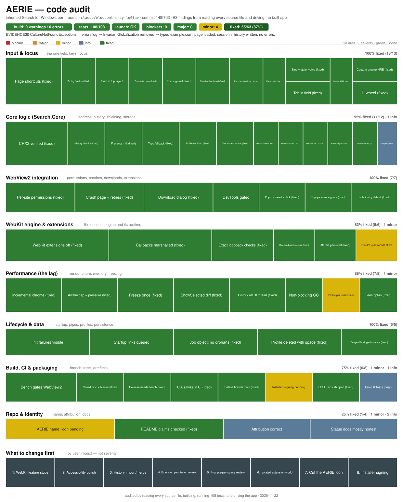

# AERIE

**Status: early development — a working prototype, not a daily driver.**

AERIE is a Windows-first browser built on Microsoft WebView2. It starts from
**Search**, the open-source browser for macOS by
[Office Commun](https://officecommun.com): the same philosophy — tabs that stay
out of the way, one field, no account, no telemetry — reimplemented for Windows
in C#/.NET.

This repository currently holds the inherited **Search for Windows** prototype.
The AERIE name is new; the application still builds as `Search.exe`, with the
original namespaces and file layout, while the identity and architecture are
being established.



*Audit of the current prototype — 63 findings: 4 blockers, 24 major, 30 minor.
Tiles are coloured by severity and sized by impact; the full map is
[docs/windows-port-audit.svg](docs/windows-port-audit.svg).*

## What works today

- One field for addresses and searches, with completion from local history
- Tabs down the side or across the top, pins, spaces, session restore
- Reading mode, element hiding, network-level ad blocking
- History, settings, private tabs, spaces with their own sign-ins
- Chrome extensions through WebView2's extension support
- An optional experimental WebKit engine (Playwright's WinCairo build)

## Known blockers

From the audit, in order of impact:

1. **Page-focused shortcuts do not reach the browser** — Ctrl+L/T/W/K/R only
   work while the chrome has focus (no `AcceleratorKeyPressed` bridge).
2. **CRX3 signatures are never verified** — an altered extension package would
   be accepted.
3. **WebKit: any page can impersonate an extension** — its runtime trusts a
   client-supplied extension id.
4. **WebKit: callbacks off the UI thread still execute** — and the eval map is
   not thread-safe.

The typing bug that made every text box read-only (`InvariantGlobalization`)
was found, fixed and verified in this tree — type `example.com`, the page
loads, history is written, and `errors.log` stays empty.

## Building

Requirements: Windows 10/11, the .NET 8 SDK or newer, and the WebView2
Evergreen Runtime (present on Windows 10 and 11 by default).

```
dotnet build Search.sln
dotnet test Search.sln
dotnet publish src/Search -c Release -r win-x64 --self-contained false -p:PublishSingleFile=true -o out
```

Run `out\Search.exe`. The framework-dependent build needs the .NET 8 Desktop
Runtime; a self-contained build is available with `--self-contained true`.

## A note on the names

The binary, namespaces, settings folder (`%LOCALAPPDATA%\Search`) and file names
still say "Search". That is deliberate for now: the audit, tests and behaviour
are unchanged by branding, and the rename comes with the product identity.

## Attribution

Search for Mac is by [Office Commun](https://officecommun.com), MIT-licensed —
see [LICENSE](LICENSE) and [THIRD-PARTY-NOTICES.md](THIRD-PARTY-NOTICES.md).
AERIE is an independent, unofficial Windows implementation; it is not affiliated
with or endorsed by Office Commun. "Search" and its icon remain Office Commun's.

The inherited port's own notes — feature table, memory measurements, WebKit
caveats — are kept in [docs/port-README.md](docs/port-README.md).
